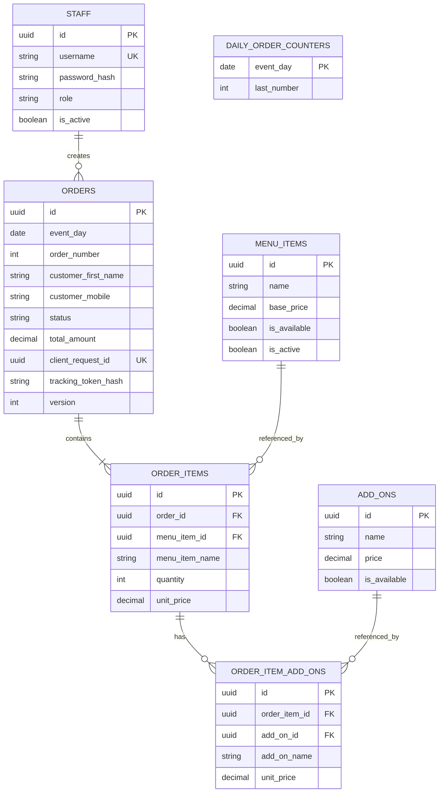

# Beans&Beats Queue

Web-based order and pickup queue management system for the **Beans&Beats** charity coffee booth at **Christmas Together 2026** (Hall F, Marina Bay Sands, Singapore · 26–29 November 2026).

|                             |                                    |
| --------------------------- | ---------------------------------- |
| **Live app**                | https://beans-beats-qms.vercel.app |
| **Demo video**              | _to be added_                      |
| **Technical summary (PDF)** | _to be added_                      |
| **Test logins**             | [below](#test-logins)              |

---

## Overview

Beans&Beats is operating a charity coffee booth at Christmas Together 2026, an event expected to welcome over 40,000 visitors, with all booth profits donated to **Singapore Red Cross Young Hearts**.

**Beans&Beats Queue** streamlines booth operations across counter staff, baristas, booth leads, and guests:

- **Counter staff** key in drink orders and customisations, charge the calculated total on the organiser's separate POS terminal, and present a tracking QR code on the receipt screen.
- **Baristas** view incoming orders in sequence and advance preparation statuses with one tap.
- **Guests** scan the receipt QR code in their phone browser—without installing an app or creating an account—to track their order in real time and receive a pickup alert when their drink is ready, or watch the public **Ready Board** at the booth.
- **Admins (booth leads)** manage menu availability and pricing, view daily cup and revenue totals, and export line-item CSV reports to reconcile against POS totals.
- **Offline resilience:** Built with IndexedDB and a service worker so staff can continue viewing the menu and queue, taking orders, and updating statuses during unstable hall Wi-Fi, syncing automatically when connectivity returns.

| Module                | Route              | Access          |
| --------------------- | ------------------ | --------------- |
| 1. Order screen       | `/order`           | Barista / Admin |
| 2. Barista queue      | `/queue`           | Barista / Admin |
| 3. Guest status page  | `/o/track#<token>` | Public          |
| 4. Ready board        | `/board`           | Public          |
| 5. Menu controls      | `/menu`            | Barista / Admin |
| 6. Daily sales report | `/report`          | Admin only      |

---

## Demo

- **Live Application:** [https://beans-beats-qms.vercel.app](https://beans-beats-qms.vercel.app)
- **Demo Video:** _To be added after recording_
- **Technical Summary (PDF):** _To be added_

### Test logins

Shared staff accounts for judges and testing staff screens on the [demo site](https://beans-beats-qms.vercel.app) and PR previews. Open a staff screen, enter either account below, and use **Sign out** before changing roles:

| Role    | Username          | Password                 | Can do                                                     |
| ------- | ----------------- | ------------------------ | ---------------------------------------------------------- |
| Admin   | `preview-admin`   | `local-preview-password` | Everything, including prices, deactivating drinks, reports |
| Barista | `preview-barista` | `local-preview-password` | Take orders, update the queue, mark items sold out         |

> **Note:** These are public test accounts. Change both passwords before the live event (26 Nov), and never use them for real staff.

Both roles can open `/order`, `/queue`, and `/menu`. Baristas can change item availability only; editing prices and deactivating/reactivating drinks require an admin. `/report` and its CSV export require admin access, including direct API requests. `/board` and guest tracking links remain public.

---

## Features

- **Counter Order Entry (`/order`, F1 & F15):**
  - Select drinks, quantities, temperature (Hot / Iced `+S$1`), and milk options (Regular / Oat `+S$1`, restricted on Espresso, Americano, and Pourover).
  - Real-time stock validation greys out submission if a selected drink or add-on becomes unavailable.
  - Captures customer first name and optional consented Singapore mobile number (8 digits starting with `8` or `9`).
  - Snapshots drink names, base prices, and add-on prices on every order line so subsequent menu edits never alter historical totals.
  - Generates a locally rendered tracking QR code on the receipt upon confirmation.
- **Barista Queue & One-Tap Status Updates (`/queue`, F4–F6):**
  - Displays today's active orders in sequence (`queued` → `preparing` → `ready` → `collected`, or `cancelled` before collection).
  - Polls every 3 seconds for live updates without manual refreshes.
  - Enforces optimistic concurrency (`version` checks) so stale status taps never silently overwrite newer state.
- **QR Order Tracking & Ready Alert (`/o/track#<token>`, F7 & F8):**
  - Each order receives a distinct cryptographic tracking token passed in the URL hash fragment (`#<token>`) so credentials are never sent in HTTP `Referer` headers or server URL logs.
  - Polls `guest_order_status` every 3 seconds while visible (backing off up to 30 seconds during connection drops) and displays a persistent pickup prompt with the order number once `ready`.
  - `/o/example` provides a labelled sample preview when database settings are absent.
- **Public Ready Board (`/board`, F9):**
  - High-contrast booth display polling `ready_orders()` every 3 seconds to show pickup numbers and customer first names ready for collection.
- **Menu & Availability Controls (`/menu`, F10–F12):**
  - Baristas and admins can toggle drinks and add-ons between in stock and sold out (`is_available`).
  - Admins can update drink base prices and option surcharges, as well as deactivate (`is_active = false`) or reactivate menu items without breaking historical order records.
- **Daily Sales Report & CSV Export (`/report`, F13 & F14):**
  - Admin-only daily summary of total cups sold and revenue grouped by Singapore business date (`Asia/Singapore`), excluding cancelled orders.
  - One-click CSV export generating one row per order line (including cancelled orders clearly marked as excluded from totals) plus daily summary totals, with zero customer personal data for safe POS reconciliation.
- **Offline Mode & Automatic Sync (F16):**
  - Caches the app shell (`public/sw.js`), menu, active queue, and verified staff session metadata in IndexedDB (`Dexie`).
  - Allows baristas to save new orders and tap status updates while offline, queuing mutations locally and replaying them idempotently (`client_request_id` and `version`) upon reconnection. Rejected submissions or conflicts are flagged as `Needs review` rather than silently dropped.
- **Staff Sessions & Role-Based Security (F17):**
  - Pre-provisioned usernames with salted `bcrypt` hashes in PostgreSQL and signed 12-hour `HttpOnly` cookies (`STAFF_SESSION_SECRET`).
  - Cross-tab sign-out notifications, per-account session storage for order drafts, and server-side verification on every protected route.
- **PDPA Personal Data Protection & Automatic Daily Reset (F18 & F19):**
  - Minimal data collection (first name required; mobile optional with explicit timestamped consent), strict public RPC boundaries that never return phone numbers, post-event anonymisation function (`erase_guest_details`), and automatic midnight `Asia/Singapore` day rollover restarting order numbers from `1`.

---

## Tech Stack

- **Framework:** [Next.js 16](https://nextjs.org/) (App Router, Route Handlers) & [React 19](https://react.dev/)
- **Language:** [TypeScript 5](https://www.typescriptlang.org/)
- **Styling:** [Tailwind CSS 4](https://tailwindcss.com/) with custom design tokens
- **Database & Backend:** [Supabase](https://supabase.com/) (PostgreSQL, `pgcrypto`, `security definer` RPCs, `@supabase/supabase-js`, `@supabase/ssr`)
- **Offline Persistence:** [Dexie.js](https://dexie.org/) (IndexedDB wrapper) & Custom Service Worker (`public/sw.js`)
- **QR Code Generation:** [`qrcode`](https://github.com/soldair/node-qrcode)
- **Testing & Tooling:** [Vitest 5](https://vitest.dev/), Happy DOM, `fake-indexeddb`, SQL regression scripts, ESLint 9, Prettier 3
- **Deployment:** [Vercel](https://vercel.com/) (Singapore `sin1`) & Supabase Cloud (Singapore)

---

## Architecture

The application enforces a strict boundary between public browser clients, authenticated staff workspaces, Next.js server route handlers, and PostgreSQL functions:

1. **Staff Workspace & Session Layer (`src/components/staff-workspace.tsx`, `src/lib/staff-server.ts`):**
   - Staff pages (`/order`, `/queue`, `/menu`, `/report`) wrap their content in `StaffWorkspace`.
   - Staff authenticate via `POST /api/staff/session`, which verifies credentials against `public.staff` (`bcrypt`) and sets a signed 12-hour `HttpOnly` cookie.
   - Every protected API route calls `checkOrigin(request)` (for mutations) and `requireStaff()` to verify the session cookie and confirm the staff record is still active in the database.
2. **Database RPC Boundary (`supabase/migrations/`):**
   - Direct table access is locked down. Staff route handlers connect with `SUPABASE_SERVICE_ROLE_KEY` and execute `security definer` PostgreSQL functions that explicitly take `p_staff_id` and verify active status and role permissions inside the database:
     - `counter_submit_order` — validates availability, snapshots prices, allocates the daily Singapore pickup number (`1, 2, 3...`), and stores the order idempotently via `client_request_id`.
     - `counter_edit_menu` — enforces barista vs. admin permissions for availability, price edits, deactivation, and reactivation.
     - `queue_orders` & `queue_update_status` — loads today's active queue and performs version-checked status transitions.
     - `report_daily_totals` & `report_csv_export` — computes admin-only daily aggregates and line-item exports.
   - Public pages (`/board` and `/o/track#<token>`) use the browser anon client (`src/lib/supabase/client.ts`) to call only `ready_orders()` and `guest_order_status(p_tracking_token)`, which never return customer mobile numbers.
3. **Offline Store & Sync Engine (`src/lib/offline-store.ts`, `src/components/offline-support.tsx`):**
   - Stores cached menu items, active queue snapshots, pending order submissions, and queued status transitions in IndexedDB via `Dexie`, scoped to the signed-in staff account.
   - Automatically flushes pending actions in sequence when connectivity is restored.



---

## Getting Started

### Prerequisites

- **Node.js** 22 or later
- **npm** (bundled with Node.js)
- **Docker Desktop** (Linux engine) — required only if running a local disposable Supabase instance via `npx supabase start`

### Installation

```bash
git clone https://github.com/bnb-qms/beans-beats-qms.git
cd beans-beats-qms
npm ci
```

### Environment Variables

Copy `.env.example` to `.env.local` and fill in your Supabase credentials and session secret:

```bash
cp .env.example .env.local
```

| Variable                               | Scope       | Description                                                                                            |
| -------------------------------------- | ----------- | ------------------------------------------------------------------------------------------------------ |
| `NEXT_PUBLIC_SUPABASE_URL`             | Browser/SSR | Supabase project API URL                                                                               |
| `NEXT_PUBLIC_SUPABASE_PUBLISHABLE_KEY` | Browser/SSR | Supabase anon / publishable key                                                                        |
| `SUPABASE_SERVICE_ROLE_KEY`            | Server only | Supabase service-role secret key (never expose with `NEXT_PUBLIC_`)                                    |
| `STAFF_SESSION_SECRET`                 | Server only | Random secret of at least 32 characters used to sign staff session cookies                             |
| `TRACKING_BASE_URL`                    | Server only | Optional canonical HTTPS origin for guest QR links (defaults to the incoming HTTPS app request origin) |

### Running Locally

Start the Next.js development server:

```bash
npm run dev
```

Open [http://localhost:3000](http://localhost:3000) in your browser.

#### Local Test Database Setup

1. Copy `supabase/config.example.toml` to `supabase/config.toml` (ignored by Git so each developer can keep local settings).
2. Start Docker Desktop, then run `npx supabase start`. This applies all migrations in `supabase/migrations/` and seeds `supabase/insert_mock_data.sql` into a local `beans-beats-qms` database.
3. Run `npx supabase status -o env` and copy the local API URL, anon key, and service-role key into `.env.local` along with a 32+ character `STAFF_SESSION_SECRET`. Restart `npm run dev`.
4. To wipe local edits and restore a clean mock dataset at any time, run `npx supabase db reset --local`.

Local mock staff accounts (never load `insert_mock_data.sql` into production):

| Role    | Username        | Password      |
| ------- | --------------- | ------------- |
| Barista | `mock_staff_02` | `MockPass02!` |
| Admin   | `mock_staff_03` | `MockPass03!` |

#### Local HTTPS & Phone Testing over Wi-Fi

QR tracking requires an HTTPS origin. To test QR scanning on a mobile phone over local Wi-Fi:

1. Set both `TRACKING_BASE_URL` and `NEXT_PUBLIC_SUPABASE_URL` in `.env.local` to your computer's Wi-Fi IP address (never `localhost` or `127.0.0.1`), using HTTPS on port `3000` for the app and port `54321` for the Supabase API.
2. Create a local certificate covering your Wi-Fi IP (`certificates/localhost.pem` and `certificates/localhost-key.pem`), enable `[api.tls]` in `supabase/config.toml`, and trust the certificate on your phone.
3. Run Next.js with HTTPS enabled (adding `--hostname <YOUR_WIFI_IP>`):

```bash
npx next dev -p 3000 --experimental-https --experimental-https-key certificates/localhost-key.pem --experimental-https-cert certificates/localhost.pem --experimental-https-ca certificates/localhost.pem
```

---

## Usage

### Staff Sessions & Handover (F17)

- Sign in on `/order`, `/queue`, `/menu`, or `/report`.
- Signing out hides protected screens and broadcasts to other open staff tabs. Returning to a hidden tab, navigating back, or reconnecting re-verifies session access with the server.
- Unsubmitted order drafts and pending offline submissions remain isolated per staff account in browser storage. Always press **Sign out** and confirm it succeeds before handing a device to another role.

### Order Entry, Queue & Guest Tracking (F1, F4–F9)

1. **Take Order (`/order`):** Select drinks and options, enter the guest's first name (and optional mobile number with consent), collect payment on the organiser's POS, and press **Submit order**.
2. **Guest QR (`/o/track#<token>`):** Ask the guest to scan the receipt QR code (or click **Open order status** during testing). The guest page polls every 3 seconds and displays a persistent pickup banner with the order number when marked **Ready**.
3. **Prepare & Hand Off (`/queue` & `/board`):** Baristas advance orders from **Queued** → **Preparing** → **Ready** → **Collected**. Orders marked **Ready** appear immediately on `/board`.

### Daily Reset Between Event Days (F19)

The system automatically rolls over to a new event day at **midnight Singapore time (`Asia/Singapore`)**. There is no manual reset button and no historical records are deleted:

- Every order belongs to the Singapore date on which the server receives it, and pickup numbers restart from `1` each day.
- `/queue` and `/board` load only today's orders, so both start empty each morning once online and refreshed.
- Past days remain accessible in `/report` (Daily Totals and CSV export).

**End-of-day checklist (26–29 Nov) for the booth lead:**

1. Check `/queue` for any remaining `Queued`, `Preparing`, or `Ready` orders and mark collected drinks as `Collected`.
2. Open `/order` on every booth device while online and verify no orders show **Pending sync** or **Needs review** (an offline order that syncs after midnight counts toward the new day).
3. Download that day's CSV from `/report` as a backup.
4. Click **Sign out** on every staff device.

**Next-morning checklist:**

- Connect every booth device to the internet, reload `/queue` and `/board`, and confirm both show no orders, no `Offline` or `Pending sync` badges, and no `Reconnecting…` banner.

### Post-Event Personal Data Clean-Up (F18)

In accordance with Singapore's PDPA and the guest privacy notice, guest first names and mobile numbers must be erased within **30 days after the event ends on 29 Nov 2026**, while keeping anonymised sales records intact.

Between **30 Nov and 29 Dec 2026**, the booth lead or database admin must:

1. Open `/order` on every booth device while online and resolve any orders showing **Pending sync** or **Needs review**.
2. Clear the application's site data on every booth device (browser settings → site data) so no offline drafts or queued orders can sync later.
3. Run the following once in the Supabase SQL Editor for the production project:

```sql
select public.erase_guest_details((now() at time zone 'Asia/Singapore')::date, true);
```

The explicit `true` includes orders submitted on the current Singapore day. It replaces customer names with `"Guest"`, nulls out mobile numbers and consent timestamps, and returns the number of anonymised orders while leaving daily totals and CSV exports unchanged.

---

## Project Structure

```text
beans-beats-qms/
├── docs/                       # Product specs, architecture, team decisions & plans
│   ├── specs/                  # Feature specifications (F01–F19)
│   ├── architecture.md         # ER diagram and database invariants
│   ├── building.md             # Developer guide for routes, RPCs, and UI patterns
│   ├── decisions.md            # Agreed team decisions and clarifications
│   └── overview.md             # Project background and requirements
├── public/
│   ├── fonts/                  # Self-hosted typography
│   └── sw.js                   # Service worker for offline app-shell caching
├── src/
│   ├── app/                    # Next.js App Router pages and API Route Handlers
│   │   ├── api/                # Protected staff API endpoints (counter, queue, report, staff)
│   │   ├── board/              # Module 4: Public Ready Board (/board)
│   │   ├── design/             # Design system reference screen (/design)
│   │   ├── menu/               # Module 5: Menu & Availability Controls (/menu)
│   │   ├── o/                  # Module 3: Guest Status Page (/o/track, /o/[id])
│   │   ├── order/              # Module 1: Counter Order Entry (/order)
│   │   ├── queue/              # Module 2: Barista Queue (/queue)
│   │   └── report/             # Module 6: Daily Sales Report & CSV Export (/report)
│   ├── components/             # Shared UI and workspace wrappers (StaffWorkspace, OfflineSupport, Button)
│   └── lib/                    # Domain logic, offline IndexedDB store, Supabase clients & unit tests
└── supabase/
    ├── migrations/             # Sequential PostgreSQL schema and RPC migrations
    ├── tests/                  # Transactional SQL regression test scripts
    ├── config.example.toml     # Template for local Supabase CLI configuration
    └── insert_mock_data.sql    # Disposable local test seed data
```

---

## Development

### Workflow

1. Pick an issue on the project board (or create one), assign yourself, and move it to **In Progress**.
2. Branch off the latest `main`: `git switch main && git pull && git switch -c 12-short-name`.
3. Write unit tests (`src/**/*.test.ts(x)`) and SQL regression assertions (`supabase/tests/*.sql`) for new logic.
4. Commit in [SE-EDU style](https://se-education.org/guides/conventions/git.html): imperative, capitalised, no full stop, subject up to 72 characters (e.g., `Add one-tap status update`).
5. Push the branch and open a PR into `main` with `Closes #<issue>`. Move the issue to **In Review**.
6. Merge once CI is green.

### Quality Checks

All five checks run in GitHub Actions CI on every pull request and must pass before merging:

```bash
npm run lint
npm run format:check   # run `npm run format` to auto-fix formatting
npm run typecheck
npm test
npm run build
```

To run SQL regression tests (`supabase/tests/*.sql`), execute them against a disposable migrated local database (each test script runs inside a transaction and rolls back its fixtures).

---

## Deployment

The production and demo application is deployed on **Vercel** (`sin1` Singapore region) backed by **Supabase** (`beans-beats-qms-sg` in Singapore).

### Applying Database Migrations

When setting up a new Supabase project or after merging a PR that adds a file in `supabase/migrations/`:

```bash
supabase login
supabase link --project-ref YOUR_PROJECT_REF
supabase migration list
supabase db push --remote
```

> **Important:** Always check `supabase migration list` before pushing to the shared hosted project, and never run `insert_mock_data.sql` or `supabase db reset` against a live database.

### Vercel Configuration

Configure the following environment variables in the Vercel project settings:

- `NEXT_PUBLIC_SUPABASE_URL`
- `NEXT_PUBLIC_SUPABASE_PUBLISHABLE_KEY`
- `SUPABASE_SERVICE_ROLE_KEY`
- `STAFF_SESSION_SECRET`
- `TRACKING_BASE_URL` (optional; defaults to the deployment's HTTPS origin)

Before storing live event data on 26 Nov, point public demo/preview environments to an isolated demo Supabase project and rotate the public preview passwords.

---

## Authors

- **Bella (Shwe Yati Oo)** ([@shweyatioo](https://github.com/shweyatioo)) — Counter Order Entry (F1) & Menu Controls (F10–F12)
- **Henry (Hein Lin Htet)** ([@Henry336](https://github.com/Henry336)) — Ready Board (F9), Personal Data Handling (F18) & Event-Day Reset (F19)
- **Poojana.V** ([@poojana326](https://github.com/poojana326)) — Barista Queue, One-Tap Status Updates & Live Queue Updates (F4–F6)
- **That Li (TL)** ([@ThatLi](https://github.com/ThatLi)) — QR Order Tracking (F7), Live Status & Ready Alert (F8) & Staff Logins (F17)
- **Win Htut** ([@winhks25](https://github.com/winhks25)) — Database Schema, Daily Sales Reports (F13), CSV Export (F14) & Offline Mode and Sync (F16)
