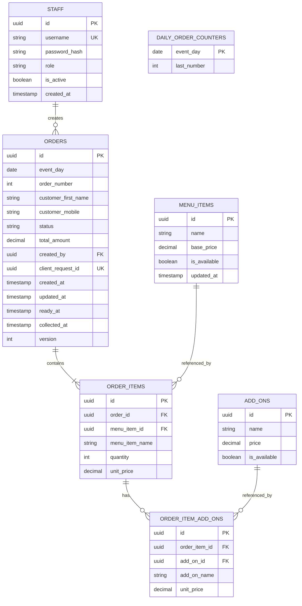

# Entity-Relation Diagram

## Data rules

- `event_day` is the booth's business date in `Asia/Singapore`, assigned when the order is accepted. `order_number` starts at 1 each event day. Enforce `UNIQUE (event_day, order_number)` and allocate numbers atomically using `DAILY_ORDER_COUNTERS`. The counter is an allocation aid, not a foreign-key parent of orders. An offline device retains the order's UUID and shows a provisional identifier until synchronization assigns the daily number. Daily reset starts a new counter row; it does not delete prior orders.
- `STAFF.id` is an internal UUID, independent of Supabase Auth. `username` is unique and `password_hash` holds a salted bcrypt hash, never plaintext. Only trusted server code may verify a submitted password; the browser cannot read staff rows or call the verification function. Production accounts are a fixed administrator-provisioned allowlist with no public signup. The mock usernames and passwords in `supabase/insert_mock_data.sql` are for disposable test data only. The app's server-side login and session flow still needs implementation before staff access works.
- The client creates `ORDERS.id` and `client_request_id` before saving locally. Retries send the same values. Enforce uniqueness on `client_request_id` so an offline retry returns the existing order instead of creating a duplicate. Insert the order and its items in one transaction. Once accepted, items and prices are immutable; corrections require an explicit cancellation and replacement order.
- `version` starts at 1. A status update supplies the version it read and succeeds only if it still matches; the server increments it atomically. On conflict, reload the current order and reconcile the requested transition. Never overwrite a newer status silently. Queue position and daily numbering come from the server after synchronization.
- `customer_first_name` is required; `customer_mobile` is nullable. The mobile number is private and must not appear on the ready board or public status page. A guest page can alert while open when the order becomes ready; SMS or push delivery would require a separately specified notification mechanism and consent rules.
- `ORDER_ITEMS.unit_price` and `ORDER_ITEM_ADD_ONS.unit_price` are price snapshots. The corresponding name snapshots keep historical receipts and exports intelligible after menu changes. Retain referenced menu and add-on rows, marking them unavailable instead of deleting them.
- Enforce `quantity > 0`, nonnegative prices and totals, and valid staff roles and order statuses. The allowed status progression is `queued` → `preparing` → `ready` → `collected`; `cancelled` can replace any status before collection. Set `ready_at` and `collected_at` on their respective transitions. Each saved order must have at least one item. Enforce `UNIQUE (order_item_id, add_on_id)` if each add-on can be selected only once per item.
- Calculate `total_amount` from item quantities and the captured base and add-on prices. An add-on price applies to every unit of its parent item. Daily reports group by `event_day`, exclude cancelled orders, sum item quantities for drink counts, and sum `total_amount` for sales totals. These are recorded order totals for comparison with the separate organiser POS, not proof of payment.
