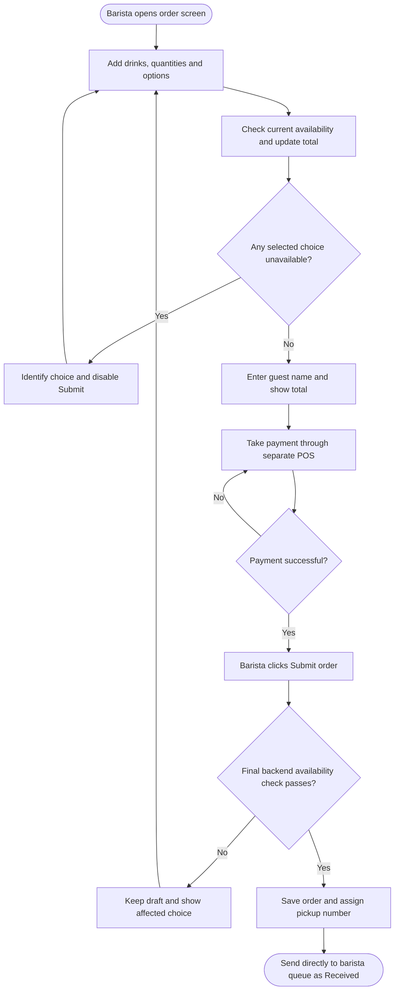

<!-- Copied from the team's Feature Specs Google Doc, tab "F1: Counter Order Entry - Bella", on 6 Nov 2026. -->

# F1: Counter Order Entry

Module: 1. Order screen
User Role: Counter Staff (Barista)
User Stories: None assigned yet
Author: shweyatioo

## 1. Overview

Counter staff enter the guest’s drinks, options and first name in the app. The app shows the total to charge through the organiser’s separate POS and checks the selected drinks and options against current availability as the order is built. After payment succeeds, the barista clicks Submit order. The app checks availability once more, saves the order and sends it directly to the barista queue as Received.

## 2. Functional Requirements

| ID   | Requirement                                                                                                                                                                                                                                                                                                                                                                                                       |
| ---- | ----------------------------------------------------------------------------------------------------------------------------------------------------------------------------------------------------------------------------------------------------------------------------------------------------------------------------------------------------------------------------------------------------------------- |
| FR1  | Only authenticated staff with order-entry permission can create orders.                                                                                                                                                                                                                                                                                                                                           |
| FR2  | Staff can add one or more drinks, choose valid temperature/milk options and enter a positive whole-number quantity for each selection. Drinks with different options remain separate order lines.                                                                                                                                                                                                                 |
| FR3  | Staff can edit quantities/options or remove lines before submitting. The app requires at least one drink and a non-blank guest first name; mobile number is optional.                                                                                                                                                                                                                                             |
| FR4  | The app calculates each line as quantity × (base price + selected option charges), then sums the lines. It displays the total in SGD with two decimal places and recalculates after edits.                                                                                                                                                                                                                        |
| FR5  | Pricing comes from the menu configuration. The current draft charges $1 per drink for iced and $1 per drink for oat milk. Milk options are not offered for espresso or black drinks.                                                                                                                                                                                                                              |
| FR6  | Whenever the barista adds, changes or removes a drink or option, the order screen checks current availability and updates the draft. If a selected drink or option is unavailable, the screen identifies it and disables Submit order until the draft is corrected. The backend checks availability again when Submit order is clicked; a newly unavailable choice blocks submission and leaves the draft intact. |
| FR7  | An accepted order stores its items, quantities, options, first name, creation time, event day and recorded prices/total. Later menu edits do not alter these snapshots.                                                                                                                                                                                                                                           |
| FR8  | After successful submission, the order screen shows the assigned pickup number, drink details and charged total. The app also assigns an internal order ID. Pickup numbers must not repeat within the same event day.                                                                                                                                                                                             |
| FR9  | After the barista clicks Submit order, the app shows “Submitting…” and temporarily disables the button. A failed submission retains the draft and shows the reason. Repeated taps or retries of the same submission must not create duplicate orders.                                                                                                                                                             |
| FR10 | After POS payment succeeds, the barista clicks Submit order. If the final availability check passes, the app saves the order and adds it directly to the barista queue as Received. The queue shows the pickup number, guest’s first name, drinks, quantities and options. There is no separate “Payment received” action.                                                                                        |
| FR11 | The barista manually enters the app’s total into the organiser’s POS and waits for payment to succeed before clicking Submit order. The app does not process or independently verify POS payment.                                                                                                                                                                                                                 |

## Dependencies / decisions to confirm

| Item                                           | Explanation / action needed                                                                                                                                                                                                                                                                                                                                                                                                                                                                                                                   |
| ---------------------------------------------- | --------------------------------------------------------------------------------------------------------------------------------------------------------------------------------------------------------------------------------------------------------------------------------------------------------------------------------------------------------------------------------------------------------------------------------------------------------------------------------------------------------------------------------------------- |
| User story for F1                              | F1 does not currently have a linked user story. Add one describing the cashier entering orders, so the feature can be traced back to a user need.                                                                                                                                                                                                                                                                                                                                                                                             |
| Payment release                                | The barista takes payment through the separate POS before clicking Submit order. A successful submission sends the order directly to the queue as Received; there is no separate payment-confirmation button.                                                                                                                                                                                                                                                                                                                                 |
| Offline order entry — coordinate with F16      | The live backend checks required by this flow cannot run during an internet outage. Align with F16 on whether new submissions pause offline or use a separately defined offline procedure.                                                                                                                                                                                                                                                                                                                                                    |
| Pickup numbering — proposed A001/B001 approach | Each cashier device registers while online and automatically receives a unique prefix: device A creates A001, A002; device B creates B001, B002. The device retains its prefix and counter across refreshes and can continue numbering offline. A newly added device must register online before issuing numbers. If counters reset daily, the event date distinguishes orders across days.                                                                                                                                                   |
| Getting orders to baristas during an outage    | Saving an order on the cashier’s device does not automatically send it to a separate offline barista device. Agree with F16 on how staff continue preparation during an outage, such as a manual handoff until syncing resumes. Device prefixes prevent duplicate numbers but do not solve this communication gap. (I think this one can just let it sit in the cashier’s device and retain inputs until things are online again and the order gets sent to the Barista queue. Might be a bit longer wait, but got nothing to do with us mah) |
| Menu and options — confirmed baseline          | Use the full menu supplied by the owner: espresso $3, latte $8, flat white $8, americano $6 and pourover $10. Iced adds $1; oat milk adds $1. Milk options are unavailable for espresso and black drinks. (The abbreviated F10 notes do not indicate a menu change. - note for chatgpt)                                                                                                                                                                                                                                                       |
| QR tracking — F7 (That Li)                     | Coordinate with That Li: F1 supplies the saved order’s identity; F7 provides its tracking URL/QR for F1 to display to the customer. Confirm when the QR appears and how it is presented at the counter.                                                                                                                                                                                                                                                                                                                                       |
| Shared pricing — F10 / Bella                   | F1 reads drink base prices and option surcharges managed through F10. Saved orders retain their recorded prices.                                                                                                                                                                                                                                                                                                                                                                                                                              |
| Permitted options — Story 30 deferred          | F1 uses the agreed, preconfigured milk/temperature options for each drink. Admin controls for changing available options or valid combinations are deferred for later reconsideration. F10 still manages existing option surcharges.                                                                                                                                                                                                                                                                                                          |

## 3. User Flow Diagram

Proposed flow — payment release is awaiting confirmation.
Proposed offline approach: retain new orders on the order-taking device until connectivity returns, then deliver them to the barista queue. Preparation may be delayed; confirm this approach with F16 (Win).

## 4. Acceptance Criteria

- Unauthorised users cannot create orders.
- Empty orders, blank first names, invalid quantities and unsupported drink options are rejected.
- An order can be submitted without a mobile number.
- Staff can edit or remove order lines before submitting. Drinks with different options remain distinguishable.
- Two iced oat lattes at S$8 base + S$1 iced + S$1 oat each total S$20.00. Adding a S$3 espresso gives S$23.00.
- Adding, changing or removing a drink or option refreshes the draft’s availability and total.
- Sold-out drinks cannot be selected, and deactivated drinks are hidden. If a selected drink or option becomes unavailable, the screen identifies it and disables Submit order until the draft is corrected.
- Switching oat milk off disables that choice on every drink that offers it. Those drinks remain orderable with their other permitted choices.
- If a menu-price update affects an unsent draft, the barista sees the updated total before taking payment. A separate price-confirmation step is not required.
- The app shows the total for manual entry into the organiser’s POS. It does not process or independently verify payment.
- The barista clicks Submit order only after POS payment succeeds.
- The backend checks drink and option availability again when Submit order is clicked. If a choice became unavailable, submission is blocked and the draft is retained for correction.
- While submitting, the app shows “Submitting…” and temporarily disables the button. A failed submission retains the draft and explains the failure.
- Repeated taps or retries of the same submission do not create duplicate orders.
- A successful submission assigns a pickup number that does not repeat within the event day, then shows the number, drink details and charged total on the order screen.
- A successfully submitted order enters the barista queue once as Received, with the correct guest name, drinks, quantities and options. No separate “Payment received” action is needed.
- Submitted orders retain their recorded prices and totals after later menu changes.
