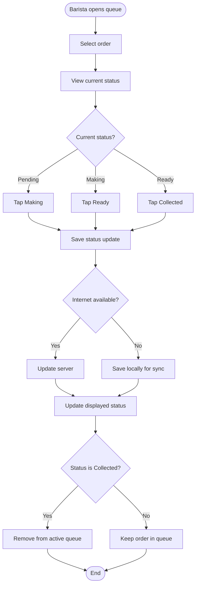

<!-- Copied from the team's Feature Specs Google Doc, tab "F5 :One-tap status updates", on 6 Nov 2026. -->

# F5: One-Tap Status Updates

Module: 2. Barista Queue
User Roles: Barista
User Stories: 3, 4, 21
Author: poojana326

## 1. Overview

The One-Tap Status Updates feature allows baristas to update an order's preparation status with a single tap.

Baristas can mark orders as Making, Ready or Collected. This helps staff track the progress of each order and identify which drinks are ready for customers.

Status changes are saved to the server when online. When offline, changes are stored locally and synchronized when the connection returns.

## 2. Functional Requirements

| ID   | Requirement                                                                                               |
| ---- | --------------------------------------------------------------------------------------------------------- |
| FR1  | Each order displays its current preparation status.                                                       |
| FR2  | Baristas can change an order's status with one tap.                                                       |
| FR3  | The system supports the status sequence: Pending → Making → Ready → Collected.                            |
| FR4  | Baristas can mark a Pending order as Making.                                                              |
| FR5  | Baristas can mark a Making order as Ready.                                                                |
| FR6  | Baristas can mark a Ready order as Collected.                                                             |
| FR7  | The system saves each status update to the server when online.                                            |
| FR8  | The updated status is reflected in the barista queue.                                                     |
| FR9  | Orders marked as Collected are removed from the active queue.                                             |
| FR10 | When offline, status changes are saved locally and synchronized when connectivity returns, following F16. |
| FR11 | The system prevents accidental repeated taps from creating duplicate status updates.                      |

## 3. User Flow Diagram

## 4. Acceptance Criteria

- Baristas can view the current status of each order.

- Baristas can update an order's status with one tap.

- Pending orders can be changed to Making.

- Making orders can be changed to Ready.

- Ready orders can be changed to Collected.

- The system follows the defined status sequence.

- Status updates are saved to the server when online.

- The queue displays the updated order status.

- Collected orders are removed from the active queue.

- Offline status updates are stored locally for synchronization.

- Repeated taps do not create duplicate status updates.
