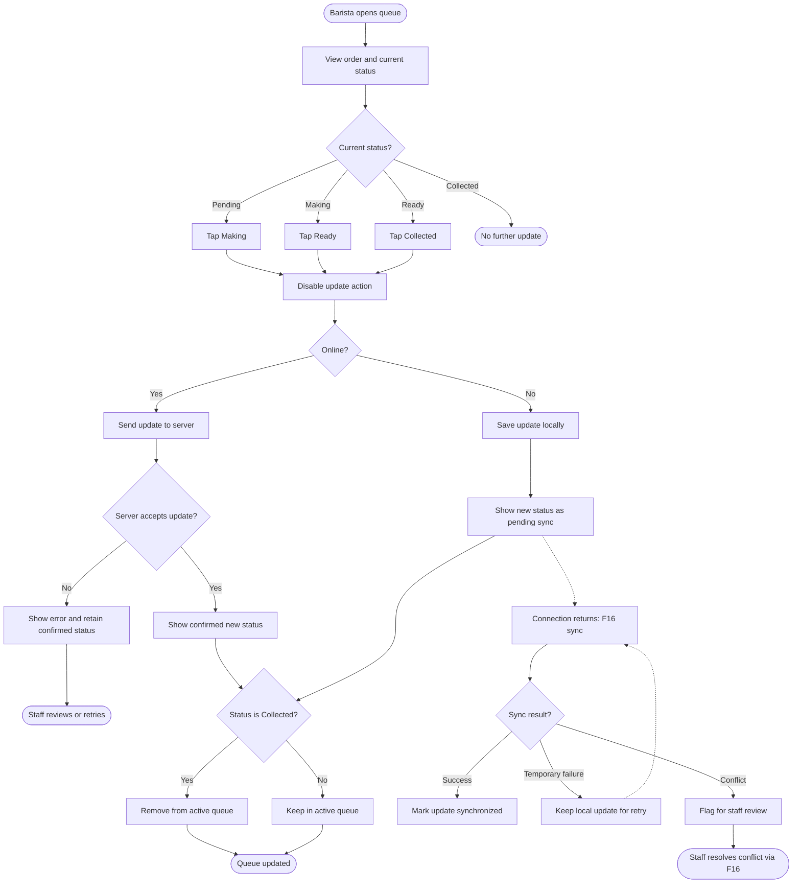

<!-- Copied from the team's Feature Specs Google Doc, tab "F5 :One-tap status updates", on 6 Nov 2026. -->

# F5: One-Tap Status Updates

**Module:** 2. Barista Queue  
**User Role:** Barista  
**User Stories:** 3, 4, 21  
**Author:** poojana326

## 1. Overview

This feature lets baristas advance an order's preparation status with one tap. Every order starts as **Pending** and progresses through **Making → Ready → Collected**. Only the next status is available; backward transitions and skipped stages are not allowed.

When online, the system sends the update to the server. When offline, it stores the update locally for later synchronization through **F16**. Conflicting offline updates require staff review.

## 2. Functional Requirements

| ID   | Requirement                                                                                                                                                              |
| ---- | ------------------------------------------------------------------------------------------------------------------------------------------------------------------------ |
| FR1  | The barista queue displays the current status of each active order.                                                                                                      |
| FR2  | New orders start with the status **Pending**.                                                                                                                            |
| FR3  | The only permitted transitions are **Pending → Making**, **Making → Ready**, and **Ready → Collected**. Backward transitions and skipped stages are not permitted.       |
| FR4  | Each active order offers a one-tap action for its next permitted status.                                                                                                 |
| FR5  | While an update is being processed, the action is disabled to prevent duplicate submissions.                                                                             |
| FR6  | When online, the system sends the update to the server and reflects the confirmed status in the queue.                                                                   |
| FR7  | If an online update fails, the system displays an error and retains the last confirmed status; staff can review and retry the update.                                    |
| FR8  | When offline, the system saves the update locally and reflects the new status in the queue as **pending synchronization**.                                               |
| FR9  | Offline updates remain stored locally until successfully synchronized according to **F16**; failed synchronization attempts do not delete them.                          |
| FR10 | If an offline update conflicts with a change made by another barista, the system flags the conflict for staff review rather than silently overwriting the server status. |
| FR11 | When an order reaches **Collected**, it is removed from the active queue. If this happens offline, the locally collected status remains pending synchronization.         |

## 3. User Flow Diagram

**Flow notes:** The dotted path represents background synchronization after an offline update; the barista does not need to remain on the queue screen. A locally collected order can disappear from the active queue before server synchronization, but its unsynchronized change must still be retained. Conflict-resolution details belong to F16.

## 4. Acceptance Criteria

- [ ] Every new order appears with the status **Pending**.
- [ ] Each active order displays its current status and a one-tap action for the next permitted status.
- [ ] A Pending order can advance to Making, a Making order to Ready, and a Ready order to Collected.
- [ ] Users cannot skip stages or move an order backward.
- [ ] Repeated taps while an update is processing do not create duplicate submissions.
- [ ] A successful online update is saved on the server and reflected in the queue.
- [ ] A failed online update shows an error without incorrectly displaying the change as confirmed.
- [ ] An offline update is saved locally and displayed as pending synchronization.
- [ ] Offline updates remain available after unsuccessful synchronization attempts.
- [ ] Conflicting offline updates are flagged for staff review rather than silently overwriting server changes.
- [ ] Collected orders disappear from the active queue, including when the update is stored locally while offline.

## 5. Dependency and Clarification

**F16 — Offline Synchronization** owns the synchronization retry and staff conflict-resolution workflow. This specification assumes offline updates are shown immediately as pending synchronization and that an online request failure is not automatically treated as an offline update. Confirm these two UI/error-handling choices with the team if they have not already been agreed.
