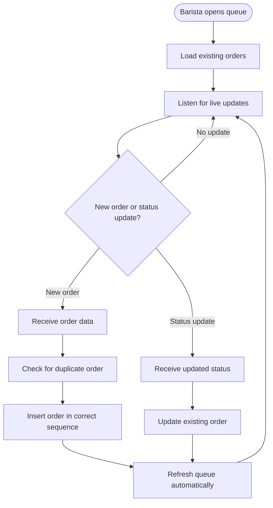

<!-- Copied from the team's Feature Specs Google Doc, tab "F6: Live Queue Updates", on 6 Nov 2026. -->

# F6: Live Queue Updates

Module: 2. Barista Queue
User Roles: Barista
User Stories: 5 (Medium)
Author: poojana326

## 1. Overview

The Live Queue Updates feature allows new customer orders to appear automatically in the barista queue without manually refreshing the page.

This helps baristas respond quickly to incoming orders, especially during busy periods.

When an order is successfully submitted, it appears in the queue in the correct sequence. Status changes made on other connected devices are also reflected automatically.

## 2. Functional Requirements

| ID  | Requirement                                                                                                                    |
| --- | ------------------------------------------------------------------------------------------------------------------------------ |
| FR1 | The system automatically updates the barista queue when a new order is successfully submitted.                                 |
| FR2 | New orders appear without requiring a page refresh.                                                                            |
| FR3 | New orders display all required information, including order number, customer name, drink, milk option and temperature.        |
| FR4 | New orders are placed in the correct sequence based on their creation time.                                                    |
| FR5 | The system automatically reflects order status changes made on other connected devices.                                        |
| FR6 | The system prevents duplicate orders from appearing when updates are received.                                                 |
| FR7 | If the connection is lost, the application displays an offline indicator.                                                      |
| FR8 | When connectivity returns, the system retrieves the latest orders and synchronizes the queue.                                  |
| FR9 | Live updates must not overwrite pending offline status changes without following the conflict handling process defined in F16. |

## 3. User Flow Diagram

## 4. Acceptance Criteria

- New orders appear automatically without refreshing the page.

- Only successfully submitted orders appear in the queue.

- New orders display the correct order number, customer name, drink, milk option and temperature.

- New orders appear in the correct sequence.

- Order status changes from other connected devices appear automatically.

- Live updates do not create duplicate orders.

- The application displays an offline indicator when connectivity is lost.

- The queue retrieves missed updates when connectivity returns.

- Pending offline status changes are not silently overwritten by live updates.
