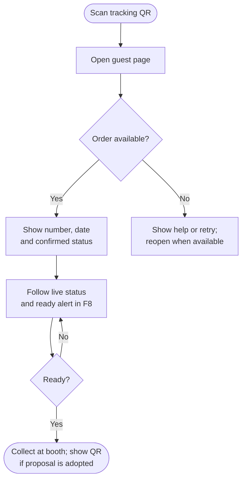

<!-- Copied from the team's Feature Specs Google Doc, tab "F7: Order tracking via QR", on 6 Nov 2026. -->

# F7: Order tracking via QR

Module: Guest status page
User Role: Customer
User Stores: 15, 18
Author: ThatLi

## 1. Overview

The customer scans the tracking QR displayed at the counter and opens a browser page for their own order. No account, app download or mobile number is required. The page shows the pickup number and the latest confirmed order status.
F7 owns the tracking link and QR supplied to F1. F8 keeps the page up to date and provides the ready alert. The System Design also proposes displaying a collection QR on this page; the collection handoff below is a proposal pending team confirmation.

## 2. Functional Requirements

| ID   | Requirement                                                                                                                                                                                                                                                                                                                                            |
| ---- | ------------------------------------------------------------------------------------------------------------------------------------------------------------------------------------------------------------------------------------------------------------------------------------------------------------------------------------------------------ |
| FR1  | For each successfully submitted order, the backend creates an order-specific tracking link using a cryptographically unpredictable token. The link resolves to the internal order ID, not the daily pickup number alone.                                                                                                                               |
| FR2  | F7 supplies the tracking URL and its QR image to F1 for display on the cashier screen. The QR contains only the HTTPS tracking URL; it contains no first name, mobile number, drink details, price or staff credential.                                                                                                                                |
| FR3  | Opening the link in a supported phone browser requires no sign-in or installation. A request with a valid token returns only that order's pickup number, event date and customer-facing status, plus its collection QR if the proposed collection handoff is adopted. It does not return names, mobile numbers, prices, staff details or other orders. |
| FR4  | The page displays the latest confirmed status and a short explanation: Received means queued, Making means being prepared, Ready means collect at the booth, and Collected means pickup is complete. Payment-pending or cancelled states are displayed only if those proposed states are adopted.                                                      |
| FR5  | A tracking token grants read-only access to one order. The server validates the token on every request; changing a pickup number or supplying a missing, malformed or invalid token does not disclose an order or allow any status change.                                                                                                             |
| FR6  | When the order is unavailable or the link has expired, show a neutral message asking the customer to check with counter staff. A temporary connection failure instead shows a retry message. Neither message reveals another order or technical details.                                                                                               |
| FR7  | The page includes the privacy notice defined by F18. Treat the tracking link as private access: do not include tokens or personal data in application logs, error messages or analytics, or send the token to unrelated third-party content.                                                                                                           |
| FR8  | An order saved only on a disconnected cashier device is not presented as available for live tracking. Show staff that tracking is pending sync, and make the link available after successful submission under F16. A failed sync does not create a second order or a replacement tracking identity.                                                    |
| FR9  | Refreshing or reopening a valid link returns the same order. A daily reset does not reassign an old token to the next day's order with the same pickup number. Displaying last-known data during a connection loss follows F8.                                                                                                                         |
| FR10 | Proposed collection handoff: when the confirmed status is Ready, show a collection QR for the same internal order. Give collection access a distinct purpose from tracking access. Displaying or opening either QR never marks an order Collected.                                                                                                     |
| FR11 | If the collection handoff is adopted, an authenticated staff workflow validates the collection token, current status and prior redemption before an authorised collection action. F7 only displays the QR and the confirmed outcome; F5 owns the Collected transition, F17 controls staff access, and F9 removes the collected order from the board.   |

## 3. User Flow

Mermaid source

## 4. Acceptance Criteria

- A submitted order has a usable tracking QR on the cashier screen, and scanning it opens its guest page without an account, app or mobile number.
- The guest page shows the correct pickup number, event date and confirmed status for the scanned order.
- Two orders with the same pickup number on different event days retain different tracking identities; an old link never opens the new order.
- Valid tracking access cannot list other orders, modify an order or access staff functions. Invalid or missing tokens disclose no order data.
- The QR payload and guest response contain no names, mobile numbers, prices or staff credentials. The guest response contains only the permitted fields and, if adopted, its own collection QR.
- A missing/expired link shows the counter-help message; a temporary network failure shows a retry/reconnecting message.
- An order awaiting offline submission is labelled pending sync on the cashier screen and is not falsely presented as live-trackable.
- Reopening a valid link preserves the order identity, and the F18 privacy notice is available.
- If the collection proposal is adopted, a Ready order displays its own collection QR, and opening or displaying that QR does not mark it Collected.
- If the collection proposal is adopted, invalid, non-Ready or redeemed collection codes cannot complete another pickup; staff-authorised collection follows F5/F17.
