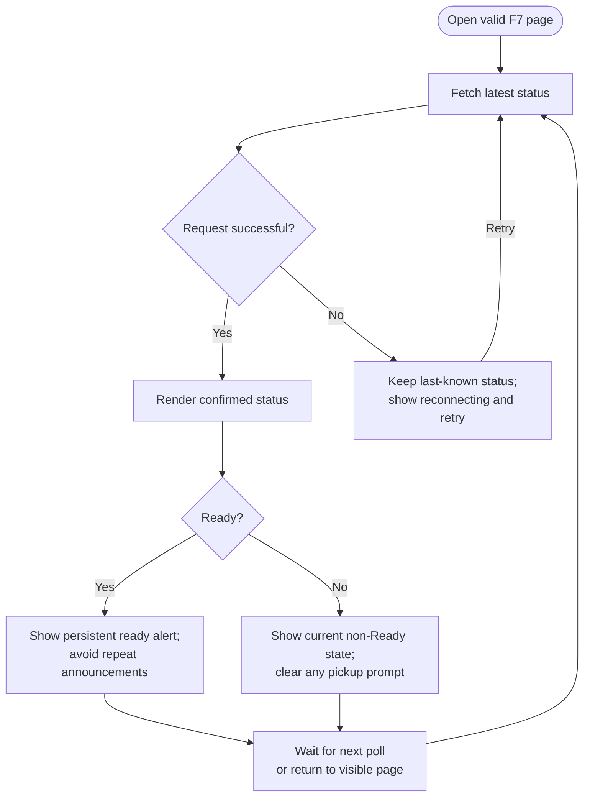

<!-- Copied from the team's Feature Specs Google Doc, tab "F8: Live status and ready alert", on 6 Nov 2026. -->

# F8: Live status and ready alert

Module: Guest status page
User Role: Customer
User Stores: 16, 17 (medium)
Author: ThatLi

## 1. Overview

The customer can keep their F7 order page open and see progress without refreshing it. When the server confirms that the order is Ready, the page clearly tells them to collect their drink at the booth.
The initial design uses short polling for guest pages, as recorded in System Design. A visible alert on the open page is the baseline. SMS, native-app notifications and guaranteed alerts while the phone is locked are outside this baseline.

## 2. Functional Requirements

| ID   | Requirement                                                                                                                                                                                                                                                                            |
| ---- | -------------------------------------------------------------------------------------------------------------------------------------------------------------------------------------------------------------------------------------------------------------------------------------- |
| FR1  | After F7 validates the tracking link, load the latest server-confirmed status and poll the same protected order endpoint while the page is open and active. The server applies the same per-order access checks on every request.                                                      |
| FR2  | Proposed polling interval: 5 seconds while the page is visible. Under a healthy connection, a confirmed status change should be reflected by the next successful poll without manual refresh. The interval is a review target, not a guarantee during outages or browser suspension.   |
| FR3  | Render the customer-facing status and its explanation from F7. Replace the displayed state with the latest confirmed response; do not simulate progress or mark an order Ready using elapsed time.                                                                                     |
| FR4  | When a valid response first shows Ready, including on initial load, display a prominent persistent message such as "Order A012 is ready. Please collect at the booth." Include the actual pickup number and make the message understandable without sound or colour alone.             |
| FR5  | Announce status changes through an accessible live region. An optional sound may play only after a user gesture enables it and the browser permits it. Denied notification permissions or unavailable sound must not block tracking or the visual ready message.                       |
| FR6  | Repeated responses for the same Ready state do not repeat a toast, announcement or optional sound. A confirmed correction away from Ready removes the ready message; a later confirmed return to Ready can alert once again.                                                           |
| FR7  | On Collected, replace the ready message with a collection-complete state and remove any active collection QR. If Cancelled is adopted, show its explanation and remove pickup prompts. Neither the guest page nor its polling can change order status.                                 |
| FR8  | On a failed request or lost connection, retain the last-known display with "Reconnecting - status may be out of date" and the last successful update time. Do not present cached Ready data as a newly confirmed readiness event or trigger a fresh alert from a failed request.       |
| FR9  | Retry transient failures with a capped delay rather than sending continuous failed requests. On reconnection or when the page becomes visible again, fetch the current status immediately and resume polling. Invalid or expired access returns to F7's unavailable-link message.      |
| FR10 | Fetch current state after recovery even if intermediate states were missed. If the latest state is Ready, show the ready message; if it is already Collected, show completion without replaying an old Ready alert.                                                                    |
| FR11 | Live guest updates depend on the barista action reaching the server. Status changes pending on an offline staff device remain local under F16; F8 must not claim to have received them. No fresh guest page is promised offline before its required assets and order data have loaded. |

## 3. User Flow

Mermaid source

## 4. Acceptance Criteria

- With a valid F7 link and a healthy connection, Received, Making, Ready and Collected changes appear without a manual refresh by the next successful scheduled poll.
- A server-confirmed Ready order displays a clear message containing its pickup number, including when the first successful load is already Ready.
- The visual ready alert works without a mobile number, notification permission or audio permission.
- The ready message is readable and announced to assistive technology without relying only on colour or sound.
- Repeated polls returning the same Ready state do not repeat transient alerts or optional audio.
- A confirmed correction from Ready removes the pickup prompt; a later return to Ready can alert once again.
- Collected replaces the ready prompt with completion and removes any active collection QR.
- During a network drop, the last-known status is labelled stale/reconnecting with its last update time; no new readiness is inferred.
- After reconnection or returning to the page, the current status is fetched without manual refresh, and duplicate polling loops are not created.
- If an outage spans Ready and Collected, recovery displays Collected and does not replay a Ready alert.
- An unsynchronised offline barista change does not appear as confirmed on another guest device. The page catches up after the action reaches the server.
- Invalid or expired tracking access stops protected polling and shows F7's help message without exposing another order.
