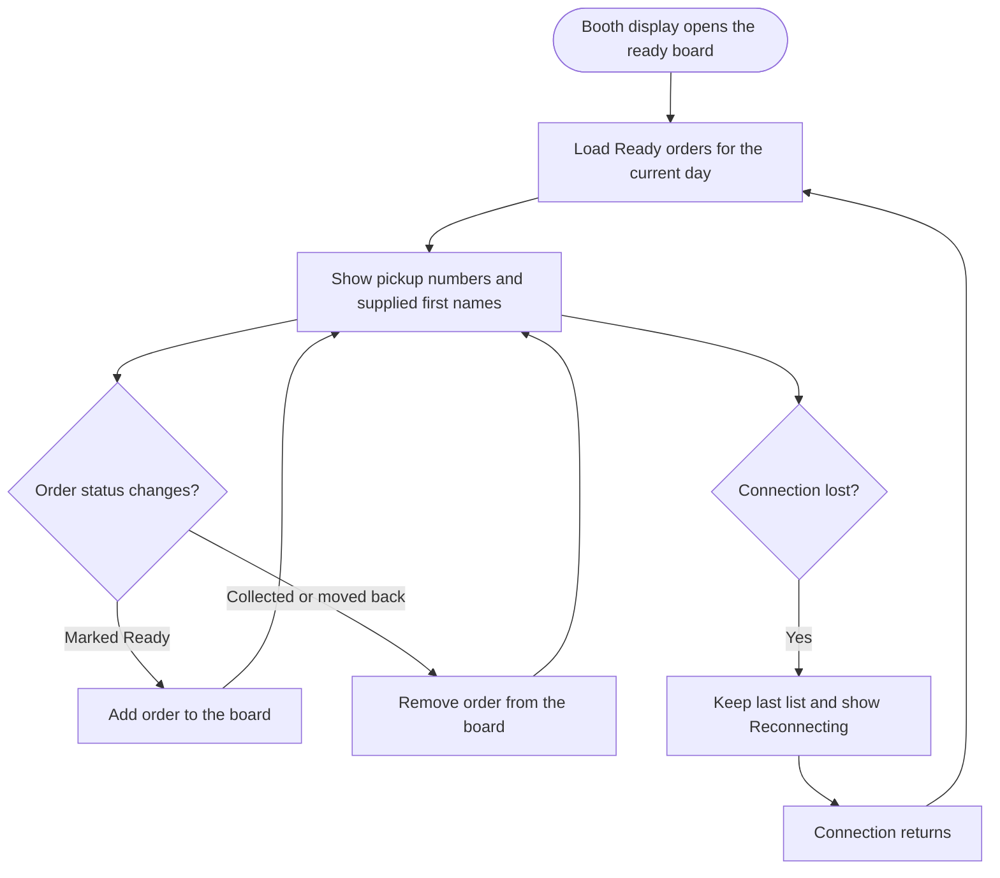

<!-- Copied from the team's Feature Specs Google Doc, tab "F9: Ready Board - Henry", on 6 Nov 2026. -->

# F9: Ready Board

Module: 4. Ready board
User Role: Customer (public booth display)
User Stories: 20, 22
Author: Henry336

## 1. Overview

The Ready Board is a public screen at the booth that lists the orders ready for pickup. Each entry shows the pickup number and, when supplied, the guest's first name, so guests know when to collect their drink.
It runs on the booth display, needs no login, updates by itself, and removes an order once it has been collected.

## 2. Functional Requirements

| ID   | Requirement                                                                                                                                                                                            |
| ---- | ------------------------------------------------------------------------------------------------------------------------------------------------------------------------------------------------------ |
| FR1  | The ready board is a public page at /board and does not require a login.                                                                                                                               |
| FR2  | The board lists every order in the current event day whose status is Ready.                                                                                                                            |
| FR3  | Each entry shows the pickup number and the guest's first name if supplied; unnamed orders show only the number.                                                                                        |
| FR4  | The data the board loads contains only the pickup number, optional first name and the time the order became Ready. Drinks, prices, mobile numbers and other order details are never sent to the board. |
| FR5  | Orders are listed in the order they became Ready, oldest first.                                                                                                                                        |
| FR6  | An order appears on the board within 5 seconds of being marked Ready, without refreshing the page.                                                                                                     |
| FR7  | An order is removed from the board when it is marked Collected, or when its status is corrected back from Ready.                                                                                       |
| FR8  | The board shows only orders from the current event day. After a daily reset (F19) it starts empty.                                                                                                     |
| FR9  | If the connection drops, the board keeps showing the last known list and displays a small "Reconnecting" notice. It catches up by itself when the connection returns (matches F16 FR14).               |
| FR10 | When no orders are ready, the board shows a short message such as "No orders ready yet".                                                                                                               |
| FR11 | The board uses large, high-contrast text so it can be read from a distance at the booth.                                                                                                               |
| FR12 | Admin can open the board in a fullscreen view for the booth display (story 22, Low priority).                                                                                                          |

To confirm: whether Cancelled becomes a status (if it does, cancelled orders are also removed from the board), and whether 5 seconds is the right target for updates.

## 3. User Flow Diagram

## Diagram PNG

## 4. Acceptance Criteria

- The board opens at /board without logging in.
- Only orders with status Ready from the current event day are shown.
- Each entry shows the pickup number and first name if supplied, and nothing else about the order.
- The board's network data contains no drinks, prices or mobile numbers.
- An order marked Ready by the barista appears within 5 seconds without a page refresh.
- An order marked Collected disappears within 5 seconds.
- An order whose status is corrected back from Ready disappears.
- Orders are listed oldest-ready first.
- The board is empty after a daily reset.
- With the connection off, the board keeps the last list and shows Reconnecting; it updates again once back online.
- An empty board shows the "No orders ready yet" message.
- Text is readable on the booth display from the guest pickup area.
- The fullscreen view works on the booth display.
