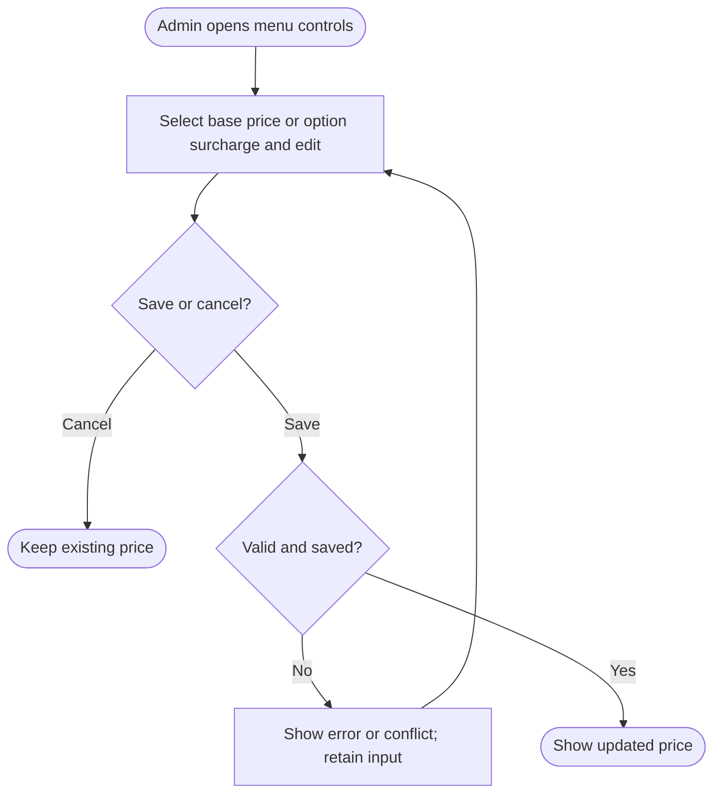

<!-- Copied from the team's Feature Specs Google Doc, tab "F10: Price changes - Bella", on 6 Nov 2026. -->

# F10: Price changes

Module: 5. Menu Controls
User Role: Admin
User Stories: 25, 28
Author: shweyatioo

## 1. Overview

Admins update drink base prices and existing option surcharges, such as iced and oat milk. F1 uses the shared pricing configuration for new orders. Saved orders retain their recorded prices so historical reports remain accurate.

## 2. Functional Requirements

| ID  | Requirement                                                                                                                                                                                                                                                            |
| --- | ---------------------------------------------------------------------------------------------------------------------------------------------------------------------------------------------------------------------------------------------------------------------- |
| FR1 | Only authenticated admins can change menu prices; the backend enforces this restriction.                                                                                                                                                                               |
| FR2 | Admins can view and select a drink base price or an existing option surcharge for editing. Amounts are displayed in SGD (no need for S$ though; I mean we’re in Singapore, everyone knows it’s Singapore dollars).                                                     |
| FR3 | Admins can enter a new price in SGD and save or cancel. The app rejects blank entries, non-numeric or negative amounts, and amounts with more than two decimal places.                                                                                                 |
| FR4 | Admins can change a drink’s base price or the extra charge for an existing option. For example, changing iced from +S2 updates that charge for every drink that offers iced. This does not change drink names, which options a drink permits, or current availability. |
| FR5 | Connected order screens receive saved price changes. If a change affects an unsent draft, the screen shows the revised total before the barista takes payment and submits the order. The backend checks current pricing on submission.                                 |
| FR6 | Submitted orders keep the prices charged when they were created. Later menu-price changes do not alter those orders or historical reports.                                                                                                                             |
| FR7 | Price changes require an internet connection. Show success only after backend acknowledgement. Failed saves retain the entered value, explain the failure and allow retry.                                                                                             |
| FR8 | If another admin changes the same item before saving, the app shows the current saved value and asks the admin to review instead of silently overwriting it.                                                                                                           |

## Dependencies / decisions to confirm

| Item              | Explanation / action needed                                                                                                                                                                                                                            |
| ----------------- | ------------------------------------------------------------------------------------------------------------------------------------------------------------------------------------------------------------------------------------------------------ |
| F1 and reporting  | F1 stores the prices charged with each saved order. Reporting reads those snapshots. Merging F15 into F1 does not remove this responsibility.                                                                                                          |
| Story 30 deferred | Permitted milk/temperature options are preconfigured from the agreed menu. Admin editing of options or valid combinations is deferred. F10 still edits existing option surcharges.                                                                     |
| F16               | Admin changes require a connection under the current F16 draft. Offline order creation remains pending team agreement. If approved, agree how to reconcile locally saved orders using older prices without silently repricing orders already paid for. |

## 3. User Flow Diagram

## 4. Acceptance Criteria

- Admins can view and change base prices and existing option surcharges; non-admin attempts are rejected.
- Invalid input is rejected with a clear message and does not alter the saved price.
- Cancelling an edit leaves the original price unchanged.
- Changing latte from $8 to $9 makes a new iced oat latte $11.00 when both add-ons remain $1.
- An affected unsaved draft receives a price-change notification and updated total without a separate price-confirmation step.
- A submitted order retains its charged prices and total after later price changes.
- Failed saves are not shown as successful; the entered value remains available for retry.
- A conflicting admin edit is surfaced for review rather than silently overwriting it.
- Changing iced from $1 to $2 makes a new iced oat latte $11.00 when latte is $8 and oat is $1; the shared surcharge applies to all drinks using it.
- Offline price saves are unavailable; item names, permitted options and availability remain unchanged by a price edit.
