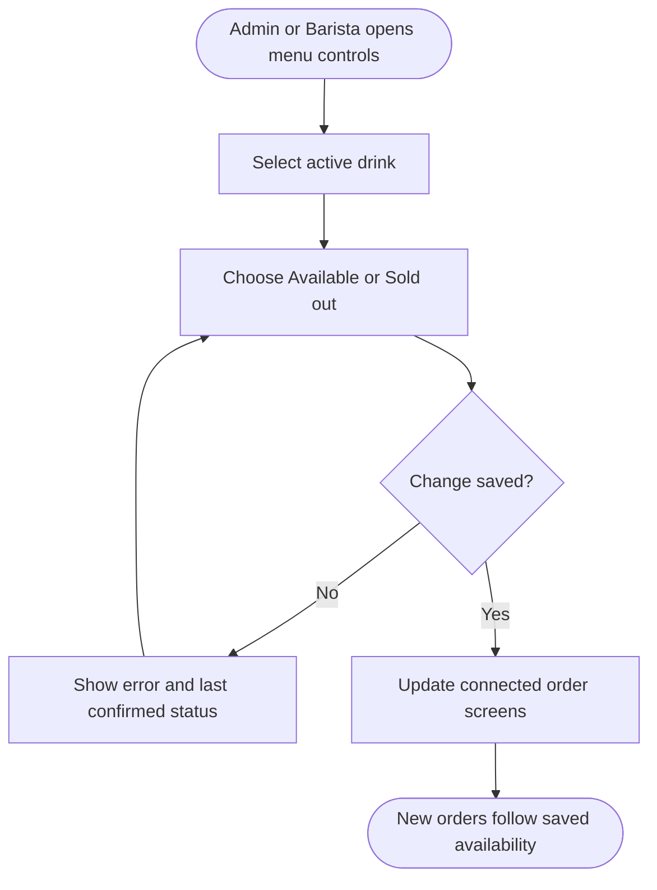

<!-- Copied from the team's Feature Specs Google Doc, tab "F11: Sold-out toggle - Bella", on 6 Nov 2026. -->

# F11: Sold-out Toggle

Module: 5. Menu Controls
User Role: Barista + Admin
User Stories: 26, 27, 28
Author: shweyatioo

## 1. Overview

Baristas and admins can manually change the availability of whole drinks and existing options such as oat milk. Both can use availability controls on their respective menu pages. Admins also have separate controls for prices, deactivation and other restricted menu changes. The app does not count physical stock automatically.

## 2. Functional Requirements

| ID  | Requirement                                                                                                                                                                                                                                      |
| --- | ------------------------------------------------------------------------------------------------------------------------------------------------------------------------------------------------------------------------------------------------ |
| FR1 | Authenticated baristas and admins can change drink and existing option availability. The backend enforces this permission.                                                                                                                       |
| FR2 | The barista menu page and admin menu page show current availability controls for active drinks and existing options. Admin-only controls remain restricted to admins.                                                                            |
| FR3 | Either role can mark an active drink Sold out or Available, and an existing option Unavailable or Available. A change takes effect after the backend saves it.                                                                                   |
| FR4 | Connected order screens receive saved availability changes. Sold-out drinks cannot be selected. An unavailable option is disabled wherever offered, while the drink’s other permitted options remain available.                                  |
| FR5 | F1 refreshes availability whenever the barista adds, changes or removes a drink or option. The backend checks again on Submit order. An unavailable selection disables or blocks submission, and the draft remains available for correction.     |
| FR6 | Restoring availability lets new orders select the drink or option again where permitted. Making an option available does not add it to drinks that never offered it; making a drink available cannot reactivate an item deactivated through F12. |
| FR7 | Availability changes do not modify prices, cancel saved orders or alter historical reports. Staff handle any unfulfillable existing order separately.                                                                                            |
| FR8 | Availability changes require an internet connection. A failed change shows an error and the last confirmed status. Repeated requests set the intended state, rather than blindly toggling it again. Conflicting edits require review.            |

## Dependencies / decisions to confirm

| Item  | Explanation / action needed                                                                                                                                                                                                                                                  |
| ----- | ---------------------------------------------------------------------------------------------------------------------------------------------------------------------------------------------------------------------------------------------------------------------------- |
| F1    | F1 automatically displays saved availability changes on connected order-entry screens and validates availability before saving new online orders.                                                                                                                            |
| F12   | Inactive items cannot be reactivated through this toggle.                                                                                                                                                                                                                    |
| Scope | F11 is a manual availability control for whole drinks and existing options. It does not count ingredient stock or automatically mark anything unavailable when stock runs low. Story 30’s controls for changing which options a drink permits remain deferred.               |
| F16   | Admin availability changes require a connection. Offline order creation is pending agreement. If approved, agree how to reconcile locally saved orders for drinks marked sold out elsewhere; do not apply unsaved-draft rejection rules automatically to those saved orders. |

## 3. User Flow Diagram

## 4. Acceptance Criteria

- Admins and baristas can mark an active drink sold out and available again; other attempts are rejected.
- Sold-out drinks are visibly unavailable and cannot be added on updated order-entry screens.
- An attempt to save a new online order using stale availability is rejected with an explanation and its draft retained.
- Marking an active drink available permits new orders again.
- Changing availability does not change prices, existing orders or historical totals.
- An inactive item cannot become orderable through this toggle.
- Failed changes retain the last confirmed state and provide a retry path.
- Retrying the same request does not reverse the intended availability state.
- Offline availability saves are unavailable, and conflicting admin/barista changes are surfaced for review.
- Switching off oat milk disables that choice on every drink that offers it; those drinks remain orderable with their other permitted choices.
- Baristas cannot use price-change or deactivation controls through their menu page.
