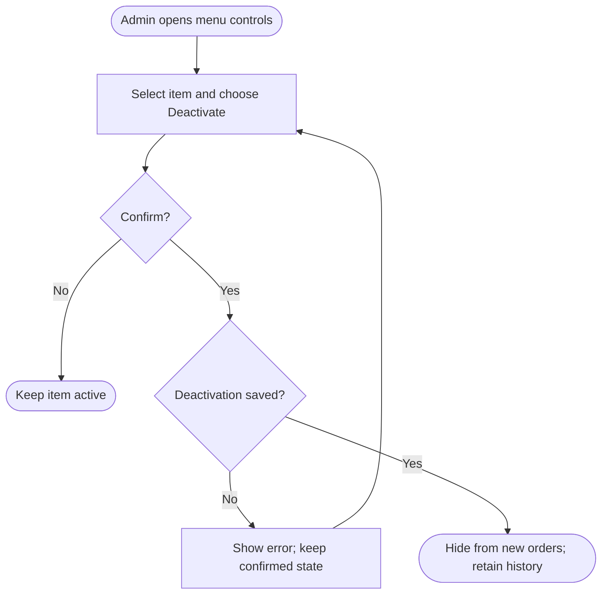

<!-- Copied from the team's Feature Specs Google Doc, tab "F12 - Deactivate menu items - Bella", on 6 Nov 2026. -->

# F12: Deactivate Menu Items

Module: 5. Menu Controls
User Role: Admin
User Stories: 29, 28
Author: shweyatioo

## 1. Overview

Admins remove an outdated drink from the active menu so staff cannot include it in new orders. This draft uses deactivation: the item remains stored so previous orders and reports stay intact. Temporary stock shortages use F11 instead.

## 2. Functional Requirements

| ID  | Requirement                                                                                                                                                                                                         |
| --- | ------------------------------------------------------------------------------------------------------------------------------------------------------------------------------------------------------------------- |
| FR1 | Only authenticated admins can deactivate menu items; the backend enforces this restriction.                                                                                                                         |
| FR2 | Admins can select an active item and choose Deactivate. The confirmation identifies the item and explains that it will be removed from new order entry while history is retained.                                   |
| FR3 | Cancelling the confirmation leaves the item unchanged. Confirming sets its active flag to false after a successful save; it does not permanently delete the item.                                                   |
| FR4 | Inactive items are hidden from order entry. Connected screens receive the saved change through the shared menu-refresh mechanism.                                                                                   |
| FR5 | The backend blocks saving a new online order containing an inactive item, including an unsaved stale draft. Staff see the affected item and can remove or replace it without losing the rest of the draft.          |
| FR6 | Existing submitted orders retain their drink details and continue through preparation and collection. Reports retain their recorded prices and quantities.                                                          |
| FR7 | Admin menu controls retain the item with an Inactive label. Marking it Available through F11 must not reactivate it.                                                                                                |
| FR8 | Deactivation requires an internet connection. The app shows success only after acknowledgement. A failed save preserves the last confirmed state and allows retry. Repeating deactivation has no additional effect. |

## Dependencies / decisions to confirm

| Item  | Explanation / action needed                                                                                                                                                                                                                                |
| ----- | ---------------------------------------------------------------------------------------------------------------------------------------------------------------------------------------------------------------------------------------------------------- |
| F1    | Connected order-entry screens hide inactive items and validate that items remain active before saving new online orders.                                                                                                                                   |
| F11   | Baristas and admins use F11 for temporary drink or option unavailability. Only admins can deactivate an outdated whole drink through F12.                                                                                                                  |
| Scope | This draft uses deactivation, not permanent deletion. Admins can explicitly reactivate an inactive drink; its price and availability flag remain unchanged. Permanent deletion remains outside scope. Story 30 option-management controls remain deferred. |
| F16   | Admin deactivation requires a connection. Offline order creation is pending agreement. If approved, agree how to reconcile locally saved orders containing drinks deactivated elsewhere without silently cancelling those orders.                          |

## 3. User Flow Diagram

## 4. Acceptance Criteria

- Admins can request deactivation; non-admin attempts are rejected.
- The confirmation identifies the drink and explains that historical records are retained.
- Cancelling leaves the item active.
- A successfully deactivated item disappears from updated order-entry screens and remains labelled Inactive in admin controls.
- The backend rejects a new online order using the inactive item and retains the draft for correction.
- Saved orders containing the item remain visible, actionable and correctly represented in reports.
- The F11 availability toggle cannot reactivate the item.
- Failure does not display success, and repeated deactivation does not delete or duplicate records.
- Offline deactivation is unavailable.

## Owner update: reactivation

Bella requested reactivation on 6 Nov. Admin controls must offer Reactivate for inactive drinks with a named confirmation. After acknowledgement, the drink returns to the active menu with its existing price and sold-out/available state. Baristas cannot reactivate, conflicting edits require review, and repeated reactivation is harmless. Existing orders and historical totals stay unchanged.
