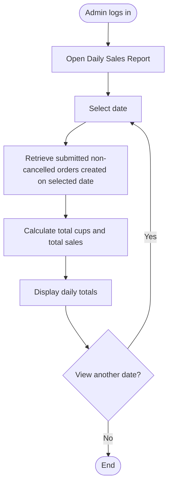

<!-- Copied from the team's Feature Specs Google Doc, tab "F13: Daily Totals - Win", on 6 Nov 2026. -->

# F13: Daily Totals

Module: 6. Daily Sales Report
User Role: Admin (Booth Lead)
User Stories: 31, 32
Author: winhks25

Owner clarification (6 Nov 2026): exclude cancelled orders, following the existing SQL.

## 1. Overview

The Daily Totals feature allows admins to view the total number of cups sold and total sales amount for each event day.
The booth lead uses these totals to compare sales recorded in the application against the organiser's POS totals at the end of each day.

## 2. Functional Requirements

| ID   | Requirement                                                                                                                                |
| ---- | ------------------------------------------------------------------------------------------------------------------------------------------ |
| FR1  | Only authenticated admins can access the daily sales report.                                                                               |
| FR2  | Admin can select a date to view its sales totals.                                                                                          |
| FR3  | System displays the total number of cups sold for the selected date.                                                                       |
| FR4  | System displays the total sales amount for the selected date in SGD.                                                                       |
| FR5  | System calculates total cups by summing the drink quantities in all successfully submitted non-cancelled orders.                           |
| FR6  | System calculates total sales by summing the recorded totals of all successfully submitted non-cancelled orders, including option charges. |
| FR7  | System uses each order's creation date to determine which day's totals it belongs to.                                                      |
| FR8  | System displays zero totals if no orders exist for the selected date.                                                                      |
| FR9  | Daily totals remain available after the event day ends and after a daily reset.                                                            |
| FR10 | Changes to menu prices must not affect historical sales totals.                                                                            |

## 3. User Flow Diagram

## Diagram PNG

## 4. Acceptance Criteria

- Admin can access the Daily Sales Report after logging in.
- Non-admin users cannot access the report.
- Admin can select an event date.
- System displays the correct total number of cups sold for that date.
- System displays the correct total sales amount in SGD.
- All successfully submitted non-cancelled orders are counted, regardless of their current preparation or collection status. Cancelled orders are excluded.
- Orders containing multiple drinks contribute the correct number of cups.
- Sales totals include charges for selected drink options.
- Each order is counted under its creation date, even if it is collected on a different date or is never collected.
- A date without orders displays 0 cups and S$0.00.
- Admin can view previous event days' totals after a daily reset.
- Daily totals do not change when menu prices are updated later.
