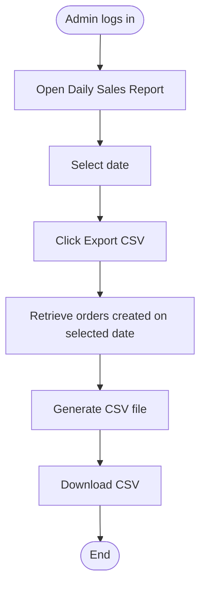

<!-- Copied from the team's Feature Specs Google Doc, tab "F14: CSV Export - Win", on 6 Nov 2026. -->

# F14: CSV Export

Module: 6. Daily Sales Report
User Role: Admin
User Story: 33
Author: winhks25

## 1. Overview

The CSV Export feature allows admins to download daily sales records as a CSV file. The admin uses the exported data to compare sales recorded in the application against the organiser's POS totals.

## 2. Functional Requirements

| ID  | Requirement                                                                                                                                                            |
| --- | ---------------------------------------------------------------------------------------------------------------------------------------------------------------------- |
| FR1 | Only authenticated admins can export sales data.                                                                                                                       |
| FR2 | Admin can select a date for the CSV export.                                                                                                                            |
| FR3 | Admin can download a CSV file containing sales records for the selected date.                                                                                          |
| FR4 | The exported data includes all successfully submitted orders created on the selected date, regardless of their current status (ie; whether they are collected or not). |
| FR5 | Each exported order includes its recorded prices, including option charges.                                                                                            |
| FR6 | The CSV file includes the total number of cups sold and total sales amount for the selected date.                                                                      |
| FR7 | Exporting a CSV file does not modify existing orders or sales data.                                                                                                    |
| FR8 | Historical sales data remains exportable after a daily reset.                                                                                                          |

## 3. User Flow Diagram

## Diagram PNG

## 4. Acceptance Criteria

- [ ] Only authenticated admins can export sales data.
- [ ] Admin can select a date and download a CSV file.
- [ ] CSV contains sales records for the selected date only.
- [ ] CSV includes all successfully submitted orders, regardless of their current status.
- [ ] Exported prices include drink prices and option charges recorded at the time of ordering.
- [ ] Total cups and total sales match the Daily Totals report (F13).
- [ ] CSV can be opened in common spreadsheet applications.
- [ ] Admin can export historical sales data after a daily reset.
- [ ] Exporting does not change any existing data.
