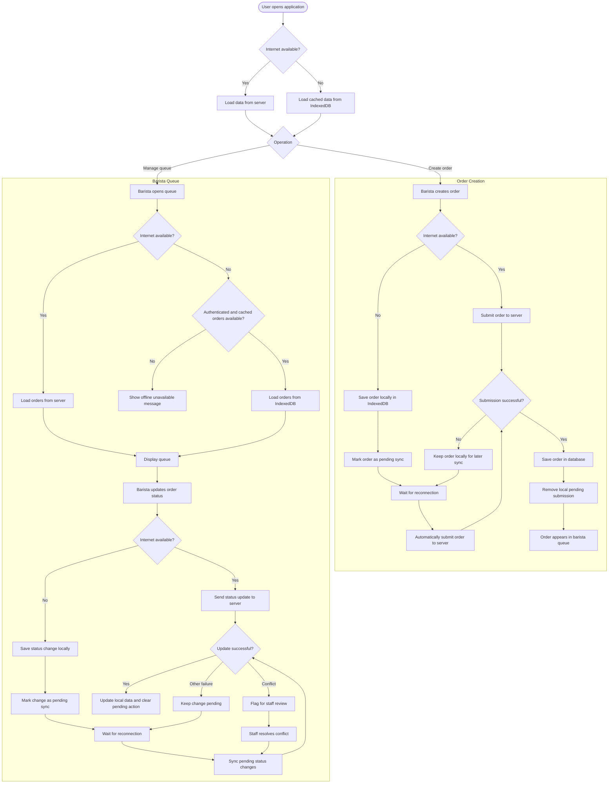

<!-- Copied from the team's Feature Specs Google Doc, tab "F16: Offline Mode and Sync - Win", on 6 Nov 2026. -->

# F16: Offline Mode and Sync

Module: All Modules
User Roles: NA
User Stories: NA
Author: winhks25

## 1. Overview

The Offline Mode and Sync feature allows the application to continue supporting essential operations during unstable or unavailable internet connections.
The barista queue can continue working offline using previously loaded orders. Status changes are saved locally and synchronized with the server when the internet connection returns.
Baristas can create orders offline. These orders are stored locally on the device and automatically submitted to the server when connectivity returns. New orders appear in the barista queue only after successful server submission.

## 2. Functional Requirements

| ID   | Requirement                                                                                                                                                                                                   |
| ---- | ------------------------------------------------------------------------------------------------------------------------------------------------------------------------------------------------------------- |
| FR1  | The application detects when the internet connection is unavailable and displays an offline indicator.                                                                                                        |
| FR2  | Previously authenticated baristas can continue using the barista queue offline on the same device.                                                                                                            |
| FR3  | The system stores previously loaded orders locally using IndexedDB (Dexie.js).                                                                                                                                |
| FR4  | Baristas can view locally stored orders while offline.                                                                                                                                                        |
| FR5  | Baristas can update order statuses offline using the normal workflow: Preparing → Ready → Collected.                                                                                                          |
| FR6  | Offline status changes are saved locally as pending actions.                                                                                                                                                  |
| FR7  | When connectivity returns, the system automatically attempts to synchronize pending actions with the server.                                                                                                  |
| FR8  | Successfully synchronized actions are removed from the pending queue.                                                                                                                                         |
| FR9  | If a local change conflicts with a server change, the system flags the conflict for staff review instead of automatically overwriting data.                                                                   |
| FR10 | The system displays synchronization status, including pending changes, failures and conflicts.                                                                                                                |
| FR11 | Baristas can create new orders while offline. These orders are saved locally using IndexedDB (Dexie.js) as pending submissions.                                                                               |
| FR12 | When internet connectivity is restored, locally saved orders are automatically submitted to the server. Successfully submitted orders are removed from local pending storage and appear in the barista queue. |
| FR13 | The application uses a service worker to make previously cached application screens available offline.                                                                                                        |
| FR14 | The ready board must be stalled (it shows the state when it was last connected and does not change).                                                                                                          |
| FR15 | The menu page is still available for view but customers cannot make orders.                                                                                                                                   |
| FR16 | The menu page remains available offline, and baristas can use it to create orders locally.                                                                                                                    |

## 3. User Flow Diagram

## Diagram PNG

## 4. Acceptance Criteria

- The application displays an offline indicator when internet access is unavailable.
- Previously authenticated baristas can access the offline queue on the same device.
- Previously loaded orders remain visible without internet access.
- Baristas can update order statuses while offline.
- Offline status changes are stored in IndexedDB.
- Pending changes are not lost when the page is refreshed or the application is reopened.
- System automatically attempts synchronization when connectivity returns.
- Successfully synchronized changes are reflected on the server.
- Successfully synchronized actions are removed from the pending queue.
- Failed synchronization attempts do not delete pending changes.
- Conflicting updates are flagged for staff review.
- Conflicting updates do not silently overwrite server data.
- Staff can review and resolve synchronization conflicts.
- Baristas can create new orders while offline, and these orders are saved locally using IndexedDB (Dexie.js).
- Locally saved orders are automatically submitted to the server when internet connectivity is restored. Orders appear in the barista queue only after successful server submission.
- Previously cached application screens can load offline.
- Pending offline orders remain saved after page refresh or application restart.
- Successfully submitted offline orders are removed from local pending storage.
- Failed order submissions remain stored locally until successfully synchronized.
