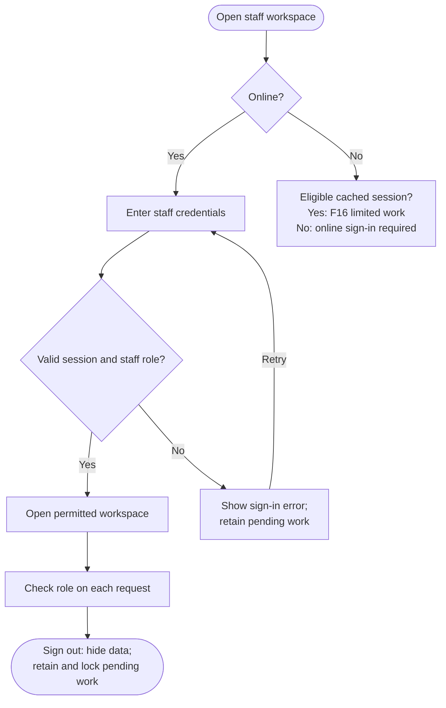

<!-- Copied from the team's Feature Specs Google Doc, tab "F17: Staff Logins", on 6 Nov 2026. -->

# F17: Staff Logins

Module: All (hard requirement)
User Role: Staff
User Stores: Not yet
Author: ThatLi

## 1. Overview

Authorised staff sign in before entering orders or using operational controls. Barista accounts support counter, preparation and collection work; booth-lead accounts also access menu controls, reports and event-day controls.
Judges receive separate barista and admin test logins for the deployed demonstration. Customers use F7 without a staff account, and the F9 ready board remains public. Existing staff can continue the limited cached offline workflow defined by F16.

## 2. Functional Requirements

| ID   | Requirement                                                                                                                                                                                                                                                                                                                                     |
| ---- | ----------------------------------------------------------------------------------------------------------------------------------------------------------------------------------------------------------------------------------------------------------------------------------------------------------------------------------------------- |
| FR1  | Use Supabase Auth with backend permission checks in Next.js Route Handlers, as specified in System Design. Proposed sign-in method: pre-provisioned email/password accounts with no public staff registration. The team must confirm this method before implementation.                                                                         |
| FR2  | Store each staff member's role in a trusted server-side record. Accept only the assigned Barista or Admin role; a missing/disabled staff record grants no staff access. A client-supplied role or hidden navigation item is not an authorisation control.                                                                                       |
| FR3  | Require authentication before loading staff pages or staff data. A successful login opens the permitted workspace; signed-out users are sent to sign-in, and signed-in users without permission receive an access-denied message.                                                                                                               |
| FR4  | Proposed permission baseline: Barista can enter orders, record payment confirmation, view the queue, update preparation status and perform the authorised collection workflow. Admin can also do these tasks and manage prices, availability, deactivation, reports, CSV export and event-day reset.                                            |
| FR5  | Enforce permissions on every protected request and relevant database access, including direct requests that bypass the UI. Guests may read only their token-authorised F7 response and F9 public display data; they cannot create orders, confirm payment, collect orders, edit menus or read sales reports.                                    |
| FR6  | Display clear loading and failure states. Invalid credentials use a generic message without confirming whether an account exists. Connection failure explains that online sign-in is unavailable; it does not create a new authenticated session. Do not log passwords or session tokens.                                                       |
| FR7  | Offer Sign out on staff screens. Signing out stops staff subscriptions and hides protected data. A later login loads only data permitted for that identity; the browser Back button must not restore an active protected workspace.                                                                                                             |
| FR8  | When the online session expires or the backend rejects it, stop protected online requests and require sign-in before uploading further work. Keep unsynchronised actions saved; after reauthentication, recheck the role and validate each action before following F16 sync.                                                                    |
| FR9  | During an outage, only a previously authenticated, eligible staff session on the same device can use its cached F16 workflow. Offline access does not grant new roles or allow a fresh sign-in. Admin menu edits, reports/export and daily reset are unavailable offline; cached order work follows F16.                                        |
| FR10 | Signing out does not silently delete pending offline work. Lock retained pending data against access by a different or signed-out user; resume it only through an authorised recovery/session flow. A role revoked elsewhere cannot be detected while disconnected, so it must be rechecked on reconnection before server actions are accepted. |
| FR11 | Provide one barista test account and one admin test account for judges on the deployed test/demo environment, with representative sample data and the same role checks as production. Keep these separate from live event accounts and data; do not publish live credentials in the repository.                                                 |
| FR12 | Document the deployed demo URL, how judges obtain/use both test accounts, their permitted screens and how demo data is reset. Pre-provisioning accounts is sufficient for this feature; self-service role management from story 48 is not part of this baseline.                                                                                |

## 3. User Flow

Mermaid source

## 4. Acceptance Criteria

- Valid barista and admin test credentials each open the permitted workspace on the deployed demonstration.
- Signed-out users cannot load protected staff data or perform mutations by opening a staff URL or calling an endpoint directly.
- A barista can perform the agreed operational actions but cannot edit menus, access reports/CSV or reset the event day; direct unauthorised requests are rejected too.
- An admin can access the operational and management functions in the agreed permission baseline.
- Changing a browser-side role value or supplying a role in a request does not increase permission. An account without an active staff assignment is denied staff access.
- Invalid credentials show a generic error, and an online connection failure does not create a new session.
- F7 guest tracking and the F9 board open without a staff login and expose only their permitted data.
- Signing out hides staff data, stops subscriptions and prevents Back navigation from restoring an authorised workspace.
- Expired/rejected online sessions require sign-in before protected requests and uploads resume; pending actions remain saved.
- A previously eligible session can use cached F16 order work on the same device offline, while a new user cannot sign in offline or gain extra permissions.
- Reconnection rechecks session and role before accepting pending actions. Rejected/conflicting actions are retained for recovery instead of silently lost.
- Signing out with pending work retains it without exposing it to another account; the agreed authorised recovery flow restores it.
- Both judge accounts use demo data, match the production permission model, and cannot access live event data. No live password, session token or privileged key is committed to the repository.
- The README explains both test roles and demo reset; no staff self-registration or permission-management screen is needed for completion.
