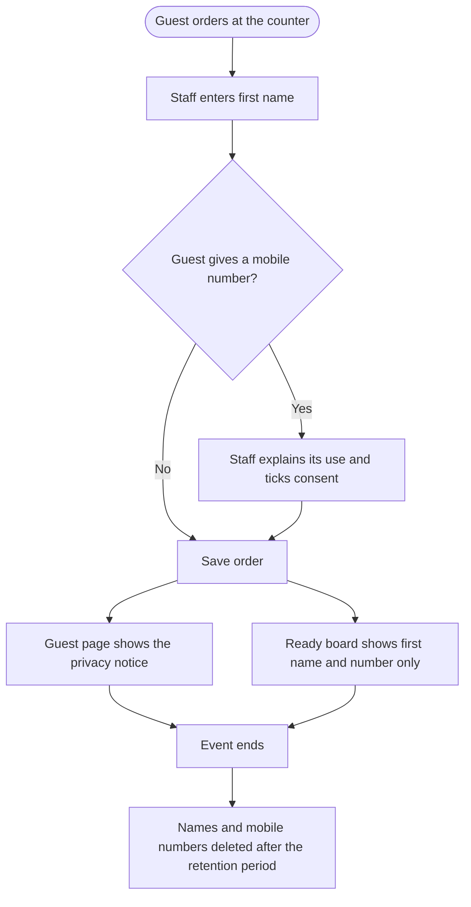

<!-- Copied from the team's Feature Specs Google Doc, tab "F18: Personal Data Handling - Henry", on 6 Nov 2026. -->

# F18: Personal Data Handling

Module: All modules (order screen, guest status page, ready board, reports)
User Role: Customer, Staff
User Stories: 55, 56, 57
Author: Henry336

## 1. Overview

The app collects as little personal data as possible: the guest's first name, and a mobile number only if the guest chooses to give one. Guests are told what the data is used for, it is shown only where it is needed, and it is removed after the event.
This keeps the booth in line with Singapore's Personal Data Protection Act (PDPA), which is a hard requirement in the brief.

## 2. Functional Requirements

| ID   | Requirement                                                                                                                                                                              |
| ---- | ---------------------------------------------------------------------------------------------------------------------------------------------------------------------------------------- |
| FR1  | The order screen asks only for the guest's first name. It never asks for a surname, email, NRIC or any other identifier.                                                                 |
| FR2  | The first name is required, trimmed of spaces, and limited to 20 characters so it fits on the ready board.                                                                               |
| FR3  | The mobile number is optional. If entered, it must be a valid Singapore mobile number (8 digits starting with 8 or 9).                                                                   |
| FR4  | A mobile number is saved only after the guest agrees to its stated use. Staff tick a consent box on the order screen after telling the guest; without the tick, the number is not saved. |
| FR5  | The guest status page shows a short privacy notice: what is collected, why, how long it is kept, and who to contact.                                                                     |
| FR6  | The ready board shows only the first name and pickup number (see F9).                                                                                                                    |
| FR7  | A guest can see only their own order, through the QR link. Order links use a hard-to-guess token, not a running number, so guests cannot look up other orders.                           |
| FR8  | Names and mobile numbers are visible only to signed-in staff on staff screens.                                                                                                           |
| FR9  | Daily totals and CSV exports contain no names or mobile numbers. They only need drinks, quantities and amounts.                                                                          |
| FR10 | Database access rules stop the public from reading names or mobile numbers directly from the database.                                                                                   |
| FR11 | Names and mobile numbers are not written to logs, error messages or analytics.                                                                                                           |
| FR12 | Names and mobile numbers are deleted within 30 days after the event ends (29 Nov). Sales records stay, without personal data.                                                            |

To confirm: which feature uses the mobile number (no current feature sends SMS, and PDPA says not to collect data we do not use; if none, the field could be left out), the 30-day retention period, and the contact named in the privacy notice (Beans&Beats or the organiser).

## 3. User Flow Diagram

## Diagram PNG

## 4. Acceptance Criteria

- An order cannot be saved without a first name.
- A first name over 20 characters, or made only of spaces, is rejected.
- An order can be saved without a mobile number.
- An invalid mobile number is rejected.
- A mobile number is not saved unless the consent box is ticked.
- The guest status page shows the privacy notice.
- The ready board shows no personal data other than first names.
- Changing the token in an order link does not show another guest's order.
- A logged-out user cannot read names or mobile numbers from the database.
- Daily totals and CSV exports contain no names or mobile numbers.
- No names or mobile numbers appear in logs or error messages.
- Running the retention clean-up removes names and mobile numbers but keeps sales totals unchanged.
