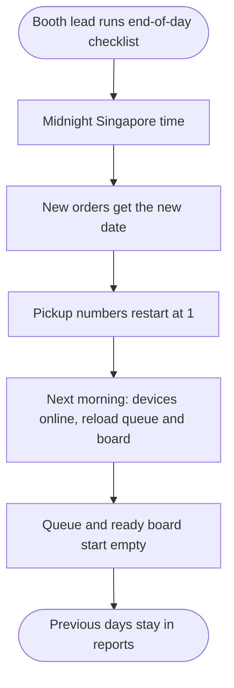

<!-- Copied from the team's Feature Specs Google Doc, tab "F19: Reset Between Event Days - Henry", on 6 Nov 2026. -->

# F19: Reset Between Event Days

Module: All modules (admin controls)
User Role: Admin (Booth Lead)
User Stories: 49, 50
Author: Henry336

## 1. Overview

At the end of each event day, the app starts a new day. The barista queue and ready board are cleared and order numbers start again from 1, but the previous day's sales stay available in the reports.
The README explains how this works, since it is part of the required deliverables. The event runs 26 to 29 Nov.

Revised 7 Nov 2026 (PR #39): the new day starts automatically at midnight Singapore time instead of from an admin "Start new day" button. The original FR3-FR5 and FR10-FR12 are replaced by the rows below. See `docs/decisions.md`.

## 2. Functional Requirements

| ID   | Requirement                                                                                                                     |
| ---- | ------------------------------------------------------------------------------------------------------------------------------- |
| FR1  | No staff action is needed to start a new event day.                                                                             |
| FR2  | Each Singapore calendar date is one event day. Every new order is linked to the date the server receives it.                    |
| FR3  | A new day starts at midnight Singapore time.                                                                                    |
| FR4  | (Replaced) No confirmation dialog. The README end-of-day checklist has staff check uncollected orders on `/queue` before close. |
| FR5  | (Replaced by FR3.)                                                                                                              |
| FR6  | Pickup numbers on the new day start again from 1.                                                                               |
| FR7  | The barista queue and ready board load only today's orders, so they are empty after midnight once they refresh while online.    |
| FR8  | No orders or sales are deleted. Previous days stay available in Daily Totals (F13) and CSV export (F14).                        |
| FR9  | Orders that were not collected stay in their day's records and count towards that day's totals.                                 |
| FR10 | A screen that is offline at midnight keeps its last loaded orders until it reconnects (F16). The README tells staff to check.   |
| FR11 | (Replaced) The rollover cannot be triggered twice, because it is the date and not an action.                                    |
| FR12 | (Replaced) No reset audit record. The day boundary is the Singapore date itself.                                                |
| FR13 | The README has a "Daily reset" section that explains these steps.                                                               |

## 3. User Flow Diagram

## Diagram PNG

## 4. Acceptance Criteria

- The first order received after midnight Singapore time gets pickup number 1.
- After midnight, a freshly loaded barista queue and ready board are empty.
- New orders are linked to the new date.
- The previous day's totals and CSV export are unchanged after midnight.
- Uncollected orders from an earlier day still count in that day's totals.
- Following the README's Daily reset steps works on the deployed app.
