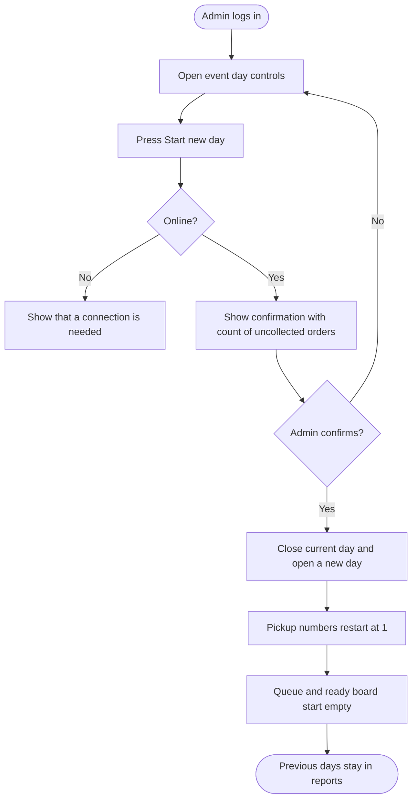

<!-- Copied from the team's Feature Specs Google Doc, tab "F19: Reset Between Event Days - Henry", on 6 Nov 2026. -->

# F19: Reset Between Event Days

Module: All modules (admin controls)
User Role: Admin (Booth Lead)
User Stories: 49, 50
Author: Henry336

## 1. Overview

At the end of each event day, the booth lead starts a new day. The barista queue and ready board are cleared and order numbers start again from 1, but the previous day's sales stay available in the reports.
The README explains how to do this, since it is part of the required deliverables. The event runs 26 to 29 Nov.

## 2. Functional Requirements

| ID   | Requirement                                                                                               |
| ---- | --------------------------------------------------------------------------------------------------------- |
| FR1  | Only authenticated admins can start a new event day.                                                      |
| FR2  | Exactly one event day is open at a time. Every new order is linked to the open day.                       |
| FR3  | Admin starts a new day from the admin page with a "Start new day" button, then confirms in a dialog.      |
| FR4  | The confirmation dialog shows how many orders from the current day are not yet Collected.                 |
| FR5  | Confirming closes the current day and opens a new day dated today (Singapore time).                       |
| FR6  | Pickup numbers on the new day start again from 1.                                                         |
| FR7  | The barista queue and ready board show only the open day's orders, so they are empty after a reset.       |
| FR8  | No orders or sales are deleted. Previous days stay available in Daily Totals (F13) and CSV export (F14).  |
| FR9  | Orders that were not collected stay in the closed day's records and count towards that day's totals.      |
| FR10 | Starting a new day needs an internet connection. The button is disabled while offline (matches F16 FR16). |
| FR11 | Pressing the button twice, or two admins pressing it at the same time, opens only one new day.            |
| FR12 | The system records which admin started each day and when.                                                 |
| FR13 | The README has a "Daily reset" section that explains these steps.                                         |

To confirm: whether uncollected orders should block the reset or only show a warning (this spec warns), and whether pickup numbers should restart at 1 or continue across days to avoid mixing up a leftover order with a new one.

## 3. User Flow Diagram

## Diagram PNG

## 4. Acceptance Criteria

- Non-admin users cannot start a new day.
- The confirmation dialog shows the correct count of uncollected orders.
- Cancelling the dialog changes nothing.
- After confirming, the first new order gets pickup number 1.
- After confirming, the barista queue and ready board are empty.
- New orders are linked to the new day.
- The previous day's totals and CSV export are unchanged after the reset.
- Uncollected orders from the closed day still count in that day's totals.
- The button is disabled while offline.
- Double-tapping the button opens only one new day.
- The admin and time of each reset are recorded.
- Following the README's Daily reset steps works on the deployed app.
